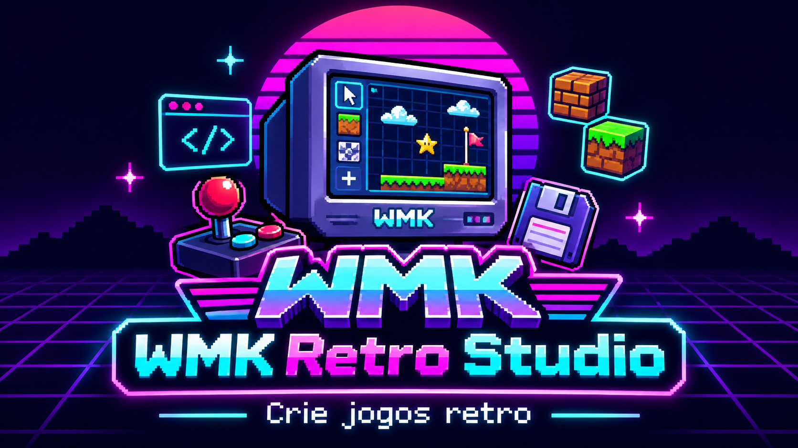

<div align="center">



# WMK Retro Studio — v0.6 (experimental)

**Crie mapas em 2D, jogue em primeira pessoa e compartilhe jogos retrô.**

**Walney Moreira Klein — walneyk@hotmail.com**  
[GitHub](https://github.com/WalneyNF/WMK-RETRO-STUDIO) · [Manual do usuário](manuais/MANUAL-USUARIO.html) · [Manual do desenvolvedor](manuais/MANUAL-DESENVOLVEDOR.html) · [Roadmap](manuais/ROADMAP.html)
</div>

## Rodando em sua máquina

**Windows 10/11:** baixe `Code → Download ZIP` no GitHub, extraia a pasta e dê duplo clique em `INICIAR-WINDOWS.cmd`. Ele abre `index.html` no navegador. Não precisa instalar Python, Node, Docker ou banco de dados para jogar e editar.

**Linux/macOS:** extraia e abra `index.html` no navegador moderno (Chrome, Edge ou Firefox). Dependendo das configurações de segurança locais, use um servidor HTTP estático: `python -m http.server 8000` e acesse `http://localhost:8000`.

**Para começar:** clique em `Mapa exemplo` → `JOGAR FPS`. Use **WASD** para andar, **setas esquerda/direita** para girar, **E** para portas, **Espaço** para atirar e **Esc** para sair. Para pintar: escolha camada e textura; clique ou arraste no mapa 2D; botão direito apaga.

## Novidades da v0.6

- Logo oficial no cabeçalho, no jogo e nos manuais; ícone de aplicação em `assets/`.
- Painéis **móveis e redimensionáveis**: arraste a barra de título e redimensione pelo canto inferior direito.
- Menu **Layouts** com salvar, carregar, renomear, excluir, restaurar, importar e exportar JSON.
- Salvamento automático da posição atual no navegador, separado do mapa.
- Manuais offline, em português: usuário, desenvolvedor e roadmap.

## Funcionalidades do protótipo

Editor de mapas 2D em grade, quatro camadas (piso, paredes, decoração e objetos), importação de tileset de parede, paredes e portas com chaves azuis/douradas, itens, inimigos simples, renderizador FPS 2.5D por raycasting, movimento e colisão, mapa exemplo, exportar/importar mapa JSON, desfazer/refazer básico.

## Limitações

É **experimental** e não é clone integral de Easy FPS Editor/Wolfenstein/Doom. Não há multiplayer, 3D geométrico completo, editor de eventos avançado, IA de inimigos com caminhos, exportador de EXE ou empacotador de jogos independente. Importação personalizada de texturas vale para paredes; pisos e decoração têm padrões internos. A funcionalidade visual deve ser testada em cada navegador. Os presets de layouts ficam no `localStorage` e podem ser apagados ao limpar os dados do navegador: **faça backup via Exportar JSON**. A licença do projeto não cobre recursos de terceiros.

## Para desenvolvedores

```text
index.html                 Interface e prévia de FPS
assets/                    Logo e ícone oficiais
css/style.css              Tema e painéis
js/core.js                 Mapa, validação, regras e jogo
js/layers.js               Camadas e serialização
js/renderer.js             Raycasting e texturas
js/app.js                  Editor e controles
js/layouts.js              Painéis e layouts locais
manuais/                   Guias HTML e roadmap
tests/test-core.js         Testes do motor
```

Executar testes: `node tests/test-core.js`. Sintaxe: `node --check js/app.js` etc.

## Licença e contribuições

O código original WMK é distribuído sob **MIT**; consulte `LICENSE`. Preserve o aviso de direitos autorais e licença ao redistribuir. Para enviar contribuições, abra Issue/PR explicando a alteração e como testar. Evite subir sprites, músicas, fontes ou marcas de jogos comerciais. Tilesets de Kenney ou terceiros devem ser importados respeitando suas licenças individuais. A arte da identidade WMK incluída é material de marca: a MIT do código não concede automaticamente direitos de marca.


## Novidade v0.6 — Biblioteca Kenney

Incluído o **Simplified Platformer Pack** de Kenney (CC0): 65 tiles, 18 itens, 8 poses de personagem, imagens PNG originais. Abra `manuais/GUIA-KENNEY-V04.html`. Os sprites decorativos do catálogo **não são entidades inteligentes**. Os mapas exportados referenciam os arquivos do catálogo na pasta `assets`.


## HUD clássico (v0.6)

No painel **Inspector → Editor de HUD clássico** customize o HUD, escolha cores, carregue uma imagem e teste com **JOGAR FPS**. O mapa JSON guarda as configurações. O guia de dimensões e formatos está em [GUIA-HUD-E-RECURSOS-V05.html](manuais/GUIA-HUD-E-RECURSOS-V05.html). Música por fase, teto texturizado, sons e partículas configuráveis estão no roadmap, não implementados nesta versão.


## Novidades v0.6 — Biblioteca própria
Importação de imagens PNG/JPG/WebP por categoria (paredes, pisos, decoração e objetos), cadastro, duplicação, substituição de imagens, colisão sólida de paredes e paredes destrutíveis com vida configurável. O JSON do mapa contém os sprites. Veja [manual completo da v0.6](manuais/GUIA-BIBLIOTECAS-V06.html). **Ainda não estão implementados:** animações por quadros, IA configurável de monstros, colisão de objetos e piso texturizado no FPS.
